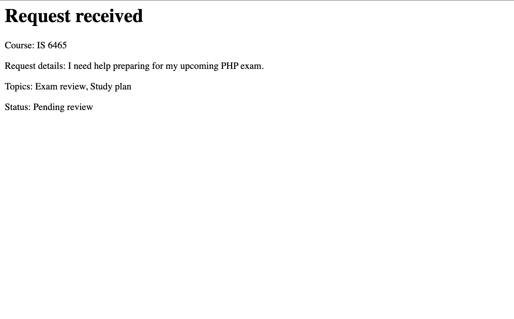

# Lab 4: Guided Application Walkthrough and Testing

## Part 1: Run the Application

I opened the Peer Tutoring Hub application in GitHub Codespaces and submitted a valid tutoring request. I selected IS 6465 as my course, chose Exam review and Study plan as my topics, and entered that I needed help preparing for my upcoming PHP exam. After submitting the form, the application displayed a "Request received" confirmation page showing my course, request details, and selected topics. The request status was listed as "Pending review."

## Part 2: Trace the Templates

**1. What content does header.php provide to every page?**

The header.php file provides the basic HTML structure for each page, including the document type, language, character settings, page title, and links to the stylesheets. This helps keep the appearance consistent across the application.

**2. What content does nav.php provide?**

The nav.php file provides the navigation bar for the Peer Tutoring Hub website. It includes links to the homepage, the Requests page, and the Request a Session page. This makes it easier for users to navigate between different parts of the application.

**3. What content does footer.php provide?**

The footer.php file provides the footer section for the Peer Tutoring Hub website. It displays the Peer Tutoring Hub name at the bottom of the page, loads the Bootstrap JavaScript file, and closes the HTML document. This helps keep the footer consistent across the application.

**4. Why is require_once appropriate for these files?**

The require_once statement allows PHP pages to reuse the same header, navigation, and footer files without repeating the code. It also makes sure each file is included only once, which helps prevent errors and keeps the application organized.

**5. Where is the shared CSS file linked?**

The shared CSS file is linked inside header.php using a link tag that points to `styles.css` in the `css` folder. The file also links to Bootstrap for additional styling.

## Part 3: Observe the Form Controls

**1. reason**

The reason field is a text area where users explain what they need tutoring help with. PHP receives the entered information as a single string.

**2. topics[]**

The topics[] field uses checkboxes that allow users to select multiple topics, such as Exam review, Practice problems, and Study plan. PHP receives the selected topics as an array of strings.

**3. preferredtime**

The preferredtime field uses radio buttons so users can select one preferred tutoring time, such as Morning, Afternoon, or Evening. PHP receives the selected time as a single string.

**4. preferreddate**

The preferreddate field allows users to select a date for their tutoring session. PHP receives the selected date as a string, typically formatted as YYYY-MM-DD.

**5. form_name**

The form_name field is a hidden input that identifies which form was submitted. PHP receives its value as a single string, which is set to tutoring_request.

## Part 4: Test Validation Behavior

### Test 1: Valid Request

**Values entered:** Course: IS 6465; Topics: Exam review and Study plan; Preferred time: Morning; Preferred date: 10/30/2026; Reason: I need help preparing for my upcoming PHP exam.

**Result:** Accepted.

**Message displayed:** "Request received" with a status of "Pending review."

**Business rule:** All required fields must contain valid information, at least one topic must be selected, and the preferred date must be today or a future date.

### Test 2: Missing Required Field

**Values entered:** Course: IS 6465; Topics: Exam review; Preferred time: Morning; Preferred date: 10/30/2026; Reason: Left blank.

**Result:** Rejected by the browser before submission.

**Message displayed:** "Please fill out this field."

**Business rule:** The reason field is required and cannot be left empty. The browser checks this before allowing the form to be submitted.

### Test 3: Past Date

**Values entered:** Course: IS 6465; Topics: Exam review; Preferred time: Morning; Preferred date: 10/20/2026; Reason: I need help reviewing PHP.

**Result:** Rejected.

**Message displayed:** "Request could not be submitted" followed by "Preferred date cannot be in the past."

**Business rule:** The preferred tutoring date must be today or a future date. The application correctly rejected the past date through server-side validation.

## Part 5: Review Testing and CRUD Pages

### Validation Test Results

I opened tests/validation-tests.php to run the provided validation tests. All 10 test cases passed successfully.

The tests included valid time, missing time, altered value, multiple valid topics, missing topics, altered topic, minimum length, maximum length, too short, and too long. Every test displayed PASS.

These results show that the application's validation functions correctly handle the tested valid and invalid inputs.

### CRUD Pages

| CRUD Action | Page |
|---|---|
| Create | request-form.php |
| Read one request | request-details.php |
| Read all requests | requests.php |
| Update | edit-request.php |
| Delete | delete-request.php |

### Edit Request Observation

I opened the Edit Request page and tried changing the preferred date and request details. When I clicked Save Changes, the form returned to its original values. After reviewing `edit-request.php`, I found that the page uses hardcoded sample request data instead of retrieving and updating a database record. The Edit page demonstrates how an update form works, but the changes are not currently saved.